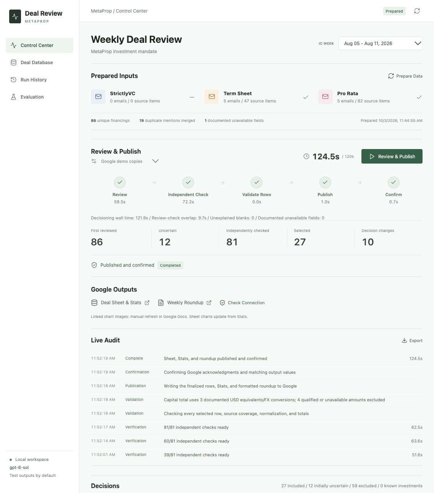

# Deal Review Control Center

An evidence-backed workflow that turns VC financing newsletters into a reviewed
deal list, weekly metrics, and a formatted Google Docs roundup.

## Why It Exists

Reviewing several daily deal newsletters means repeatedly finding the same
companies, researching missing details, checking investment fit, and copying
results into reports. This project connects those steps while keeping the
sources and decisions inspectable.

The local control center exposes preparation, review, publication, run history,
company evidence, and historical evaluation in one interface.



*Historical demo: 86 financings reviewed, 81 independently checked, and 27
selected. The displayed 124.5 seconds covers server-side review, publication,
and readback, not email collection, web research, or linked-chart refresh.
This screenshot predates the current Capital Announced policy.*

## How It Works

```text
Prepare Data
Newsletters -> extract every financing -> deduplicate -> web research
            -> normalize fields -> freeze source-backed inputs

Review & Publish
Mandate review -> route uncertain and high-risk decisions
               -> independent check -> final Yes/No decisions
               -> validate rows -> Google Sheet + Stats + roundup
               -> confirm output agreement
```

- **Source-backed research:** company sites, announcements, and product/customer
  pages support facts and actual applications, not just keyword matches.
- **Confidence-based routing:** uncertain cases, proposed exclusions, ambiguous
  identities, and evidence-backed row corrections receive an independent check.
- **Entity resolution:** names and domains are matched against a supplied
  portfolio snapshot, with fuzzy matches routed for review. No live CRM is connected.
- **Consistent outputs:** the same finalized Yes rows feed the Sheet, four-week
  Stats, and roundup. No unresolved Maybe appears in the completed output.
- **Normalization:** USD dollar-only amounts, standard round labels, and dated
  exchange-rate evidence. Capital Announced measures reported VC round amounts,
  not verified cash closed.
- **Audit and feedback:** sources, decisions, corrections, unavailable fields,
  model usage, timestamps, and input hashes remain in local records.
- **User corrections:** repair missing or incorrect fields from the dataset or
  company panel, and change final mandate fit from Decisions or the same panel.
  Evidence and correction notes are retained with the original AI checks. Local
  totals update immediately; fit-affecting edits require confirmation or a
  targeted company recheck. Refresh Outputs republishes the corrected package.
  Historical evaluation continues scoring the original model decision.

## What Has Been Verified

The latest local test run passed **144 backend tests and 25 frontend tests**.
Tests cover routing, normalization, deduplication, currency handling, publication
contracts, and interface state.

Historical Google demo runs exercise publication and fresh readback. Readback
checks output agreement, links, and formatting; it does **not** independently
prove every source fact or investment-fit decision is correct. The historical
evaluation labels are diagnostic, not a blind representative accuracy benchmark.

The under-two-minute review/publication target remains an optimization goal,
not a proven guarantee. Preparation includes web research and is timed separately.
Both fit reviewers use the same prepared evidence; the independent checker does
not conduct a second live web search. Linked charts in Docs currently need a
separate manual refresh.

## Code And Setup

The application uses **Python, FastAPI, SQLite, React/Vite, the Codex CLI,
and Google Sheets/Docs APIs**. Model work is coordinated by a bounded local
worker pool; no separate paid orchestration service is required.

```text
control_center/       Application, research/review pipeline, Google publisher, tests
control_center/references/  Mandate and newsletter-source configuration
docs/                Handoff, operating notes, and publication-readiness review
```

Start with the [Control Center setup and architecture](control_center/README.md).
The app is local-only and production publishing is disabled by default.
The app starts without private historical assets. To process real deals, configure
Google authorization and authenticate the Codex CLI. Historical newsletter
archives and portfolio snapshots are optional local inputs and intentionally
excluded; this repository does not ship a synthetic dataset.

The Control Center owns its extraction, research, review, verification, and
publication code. Follow [AGENTS.md](AGENTS.md) for development guidance.

## Privacy And Publication

Credentials, newsletter bodies, portfolio exports, databases, and run artifacts
are excluded from Git. Google account and output identifiers live in ignored
local settings; committed examples use placeholders. Review the
[publication-readiness audit](docs/publication-readiness.md) before changing
repository visibility. No public deployment or open-source license is included.
